# rasa-chatbot-widget

<!-- Auto Generated Below -->

## Properties

| Property                  | Attribute                   | Description                                                                                                                                                                      | Type                                                                                     | Default                    |
| ------------------------- | --------------------------- | -------------------------------------------------------------------------------------------------------------------------------------------------------------------------------- | ---------------------------------------------------------------------------------------- | -------------------------- |
| `accentColor`             | `accent-color`              | Brand color used for the launcher, the visitor's messages, buttons and accents. A hex value also derives readable text colors for use on and around it.                          | `string`                                                                                 | `undefined`                |
| `authenticationToken`     | `authentication-token`      | User authentication token                                                                                                                                                        | `string`                                                                                 | `''`                       |
| `autoOpen`                | `auto-open`                 | If set to True, it will open the chat, triggering the 'initialPayload' immediately if set.                                                                                       | `boolean`                                                                                | `false`                    |
| `botIcon`                 | `bot-icon`                  | Static icon for the chatbot                                                                                                                                                      | `string`                                                                                 | `''`                       |
| `brandPresence`           | `brand-presence`            | How much of the window carries the brand color: `subtle` (only the launcher, avatar and send button), `balanced`, or `expressive` (a brand-color header above the conversation). | `"balanced" \| "expressive" \| "subtle"`                                                 | `undefined`                |
| `bubbleStyle`             | `bubble-style`              | Message bubble shape: `tail`, `soft` (evenly rounded) or `minimal` (no bubble behind bot messages).                                                                              | `"minimal" \| "soft" \| "tail"`                                                          | `undefined`                |
| `buttonStyle`             | `button-style`              | Quick reply and suggestion buttons: `outline`, `soft` (tinted), `solid`, or `auto` to follow the brand presence.                                                                 | `"auto" \| "outline" \| "soft" \| "solid"`                                               | `undefined`                |
| `connectedText`           | `connected-text`            | Header status text while the widget is connected and no subtitle is set.                                                                                                         | `string`                                                                                 | `'Online'`                 |
| `cornerRadius`            | `corner-radius`             | Corner radius of the chat window in px. Bubbles, buttons, the composer and the launcher follow it.                                                                               | `number`                                                                                 | `undefined`                |
| `density`                 | `density`                   | Spacing between messages: `comfortable` or `compact`.                                                                                                                            | `"comfortable" \| "compact"`                                                             | `undefined`                |
| `disconnectedText`        | `disconnected-text`         | Header status text while the widget is connecting and no subtitle is set.                                                                                                        | `string`                                                                                 | `'Connecting…'`            |
| `displayTimestamp`        | `display-timestamp`         | Indicates if a message timestamp should be displayed                                                                                                                             | `boolean`                                                                                | `false`                    |
| `elevation`               | `elevation`                 | Shadow depth of the chat window and launcher: `flat` (border only), `soft` or `lifted`.                                                                                          | `"flat" \| "lifted" \| "soft"`                                                           | `undefined`                |
| `enableFeedback`          | `enable-feedback`           | If set to True, shows conversation feedback component at the bottom of the chat.                                                                                                 | `boolean`                                                                                | `false`                    |
| `errorMessage`            | `error-message`             | Message that should be displayed if an error occurs                                                                                                                              | `string`                                                                                 | `'Something bad happened'` |
| `feedbackQuestionText`    | `feedback-question-text`    | Text for the feedback question. If empty, feedback component will not be shown.                                                                                                  | `string`                                                                                 | `''`                       |
| `feedbackThankYouText`    | `feedback-thank-you-text`   | Text for the thank you message after feedback submission. If empty, no thank you message will be shown.                                                                          | `string`                                                                                 | `''`                       |
| `fontFamily`              | `font-family`               | Font family to use for the widget. Defaults to the visitor's system font.                                                                                                        | `string`                                                                                 | `''`                       |
| `headerGreeting`          | `header-greeting`           | Greeting shown in the header when `headerLayout` is `hero`.                                                                                                                      | `string`                                                                                 | `'How can we help today?'` |
| `headerLayout`            | `header-layout`             | Header layout: `compact`, or `hero` with a large greeting under the title.                                                                                                       | `"compact" \| "hero"`                                                                    | `undefined`                |
| `headingFont`             | `heading-font`              | Typeface for the header title and greeting: `sans`, `rounded` or `serif` (system fonts).                                                                                         | `"rounded" \| "sans" \| "serif"`                                                         | `undefined`                |
| `headingWeight`           | `heading-weight`            | Weight of the header title and greeting: `regular`, `semibold` or `heavy`.                                                                                                       | `"heavy" \| "regular" \| "semibold"`                                                     | `undefined`                |
| `hideCloseButton`         | `hide-close-button`         | Hides the close button in the chat header.                                                                                                                                       | `boolean`                                                                                | `false`                    |
| `initialPayload`          | `initial-payload`           | Data that should be sent on Chat Widget initialization                                                                                                                           | `string`                                                                                 | `''`                       |
| `inputMessagePlaceholder` | `input-message-placeholder` | Message placeholder for input                                                                                                                                                    | `string`                                                                                 | `'Type your message here'` |
| `launcherLabel`           | `launcher-label`            | Text shown next to the launcher icon. When empty, the launcher is icon-only.                                                                                                     | `string`                                                                                 | `''`                       |
| `messageDelay`            | `message-delay`             | Delay between receiving and printing the first message of a bot reply. The rest follow right away.                                                                               | `number`                                                                                 | `600`                      |
| `messageTimestamp`        | `message-timestamp`         | Format of the message timestamp                                                                                                                                                  | `string`                                                                                 | `''`                       |
| `position`                | `position`                  | Which corner of the page the launcher and chat window are anchored to.                                                                                                           | `"bottom-left" \| "bottom-right"`                                                        | `'bottom-right'`           |
| `preset`                  | `preset`                    | Starting point for the look: `precise` (quiet, monochrome), `balanced` or `bold` (brand-color header, heavy type). Any appearance prop set on its own overrides the preset.      | `"balanced" \| "bold" \| "precise"`                                                      | `undefined`                |
| `restEnabled`             | `rest-enabled`              | If set to True, instead of the default WebSocket communication, the widget will use the HTTP protocol.                                                                           | `boolean`                                                                                | `false`                    |
| `senderId`                | `sender-id`                 | ID of a user engaged with the Chat Widget                                                                                                                                        | `string`                                                                                 | `''`                       |
| `serverUrl` _(required)_  | `server-url`                | Url of the Rasa chatbot backend server (example: https://example.com)                                                                                                            | `string`                                                                                 | `undefined`                |
| `sessionStartedText`      | `session-started-text`      | Text to display before the session start date in session divider                                                                                                                 | `string`                                                                                 | `'Session started on'`     |
| `streamMessages`          | `stream-messages`           | If set to True, bot messages will be received as stream (printing word by word).                                                                                                 | `boolean`                                                                                | `false`                    |
| `suggestedPrompts`        | `suggested-prompts`         | Conversation starters shown as tappable chips until the visitor sends a message. Accepts an array, a JSON array string, or a comma separated string.                             | `string \| string[]`                                                                     | `[]`                       |
| `textSize`                | `text-size`                 | Size of message text: `small`, `medium` or `large`.                                                                                                                              | `"large" \| "medium" \| "small"`                                                         | `undefined`                |
| `theme`                   | `theme`                     | Color theme. One of `light` (default), `dark`, `auto` (follows the visitor's OS setting), or a designer preset: `midnight`, `ocean`, `forest`, `sunset`, `mono`.                 | `"auto" \| "dark" \| "forest" \| "light" \| "midnight" \| "mono" \| "ocean" \| "sunset"` | `'light'`                  |
| `toggleFullScreen`        | `toggle-full-screen`        | Indicates whether the chat messenger can be toggled to full screen mode.                                                                                                         | `boolean`                                                                                | `false`                    |
| `welcomeMessage`          | `welcome-message`           | Text shown at the top of an empty conversation, above the first messages.                                                                                                        | `string`                                                                                 | `''`                       |
| `widgetIcon`              | `widget-icon`               | Static icon for the widget                                                                                                                                                       | `string`                                                                                 | `''`                       |
| `widgetSubtitle`          | `widget-subtitle`           | Line shown under the title in the header. When empty, the header shows the connection status.                                                                                    | `string`                                                                                 | `''`                       |
| `widgetTitle`             | `widget-title`              | Title of the Chat Widget                                                                                                                                                         | `string`                                                                                 | `'Rasa Widget'`            |

## Events

| Event                           | Description                                                                                                                                           | Type                                                                       |
| ------------------------------- | ----------------------------------------------------------------------------------------------------------------------------------------------------- | -------------------------------------------------------------------------- |
| `chatSessionStarted`            | Emitted when the Chat Widget is opened by the user                                                                                                    | `CustomEvent<{ sessionId: string; }>`                                      |
| `chatWidgetClosed`              | Emitted when the Chat Widget is closed by the user                                                                                                    | `CustomEvent<undefined>`                                                   |
| `chatWidgetFeedbackSubmitted`   | Emitted when conversation feedback is submitted. The `rating` value matches the Rasa CALM `csat_score` slot vocabulary (`satisfied` / `unsatisfied`). | `CustomEvent<{ rating: "satisfied" \| "unsatisfied"; helpful: boolean; }>` |
| `chatWidgetFileStartedDownload` | Emitted when a user is starting to download a file.                                                                                                   | `CustomEvent<undefined>`                                                   |
| `chatWidgetHyperlinkClicked`    | Emitted when a user clicks on a hyperlink option.                                                                                                     | `CustomEvent<undefined>`                                                   |
| `chatWidgetOpened`              | Emitted when the Chat Widget is opened by the user                                                                                                    | `CustomEvent<undefined>`                                                   |
| `chatWidgetQuickReply`          | Emitted when the user click on quick reply                                                                                                            | `CustomEvent<string>`                                                      |
| `chatWidgetReceivedMessage`     | Emitted when the user receives a message                                                                                                              | `CustomEvent<unknown>`                                                     |
| `chatWidgetSentMessage`         | Emitted when the user sends a message                                                                                                                 | `CustomEvent<string>`                                                      |

## Dependencies

### Depends on

- [rasa-session-divider](../components/session-devider)
- [chat-message](../components/message)
- [rasa-text-message](../components/text-message)
- [rasa-image-message](../components/image-message)
- [rasa-video](../components/video)
- [rasa-file-download-message](../components/file-download-message)
- [rasa-accordion](../components/accordion)
- [rasa-text](../components/text)
- [rasa-quick-reply](../components/quick-reply)
- [rasa-carousel](../components/carousel)
- [rasa-rating](../components/rating)
- [global-error-handler](../components/error-handler)
- [rasa-typing-indicator](../components/typing-indicator)
- [rasa-conversation-feedback](../components/conversation-feedback)
- rasa-icon-close-chat
- rasa-icon-chat
- rasa-icon-robot
- rasa-icon-chevron-down
- [error-toast](../components/error-toast)
- [rasa-chat-input](../components/rasa-chat-input)

### Graph

```mermaid
graph TD;
  rasa-chatbot-widget --> rasa-session-divider
  rasa-chatbot-widget --> chat-message
  rasa-chatbot-widget --> rasa-text-message
  rasa-chatbot-widget --> rasa-image-message
  rasa-chatbot-widget --> rasa-video
  rasa-chatbot-widget --> rasa-file-download-message
  rasa-chatbot-widget --> rasa-accordion
  rasa-chatbot-widget --> rasa-text
  rasa-chatbot-widget --> rasa-quick-reply
  rasa-chatbot-widget --> rasa-carousel
  rasa-chatbot-widget --> rasa-rating
  rasa-chatbot-widget --> global-error-handler
  rasa-chatbot-widget --> rasa-typing-indicator
  rasa-chatbot-widget --> rasa-conversation-feedback
  rasa-chatbot-widget --> rasa-icon-close-chat
  rasa-chatbot-widget --> rasa-icon-chat
  rasa-chatbot-widget --> rasa-icon-robot
  rasa-chatbot-widget --> rasa-icon-chevron-down
  rasa-chatbot-widget --> error-toast
  rasa-chatbot-widget --> rasa-chat-input
  rasa-session-divider --> rasa-text
  chat-message --> rasa-icon-robot
  chat-message --> rasa-text
  rasa-text-message --> rasa-text
  rasa-image-message --> rasa-image
  rasa-image-message --> rasa-text
  rasa-image --> rasa-icon-default-image-fallback
  rasa-file-download-message --> rasa-icon-paperclip
  rasa-file-download-message --> rasa-text
  rasa-accordion --> rasa-text
  rasa-accordion --> rasa-icon-chevron-down
  rasa-quick-reply --> chat-message
  rasa-quick-reply --> rasa-text
  rasa-quick-reply --> rasa-link-button
  rasa-quick-reply --> rasa-button
  rasa-link-button --> rasa-icon-external-link
  rasa-carousel --> rasa-image-message
  rasa-carousel --> rasa-icon-chevron-down
  rasa-typing-indicator --> chat-message
  error-toast --> rasa-icon-danger
  error-toast --> rasa-text
  rasa-chat-input --> rasa-icon-paper-plane
  style rasa-chatbot-widget fill:#f9f,stroke:#333,stroke-width:4px
```

----------------------------------------------

*Built with [StencilJS](https://stenciljs.com/)*
